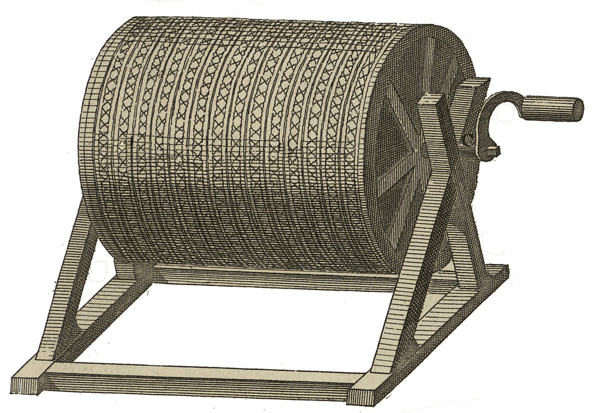

<div align="center" id="head">

<table>
<tr>
<td></td>
<td align="left">
<h1 style="margin:0">BookScan</h1>
<p style="margin:0.25em 0 0"><strong>Escaneo de libros · Companion · Android / PC</strong><br/>bookscan · pipeline OpenCV / Rust</p>
</td>
</tr>
</table>

<a href="https://atelier.atechnologie.fr/" title="l'Atelier – asociación de fabricación de libros y herramientas de investigación"></a>  
<sub>Desarrollado por <a href="https://atelier.atechnologie.fr/">l'Atelier</a> — fabricación de libros y herramientas de investigación (EHESS)</sub>

<p>
🇫🇷 <a href="README.md">Français</a> ·
🇬🇧 <a href="README.en.md">English</a> ·
🇩🇪 <a href="README.de.md">Deutsch</a> ·
🇪🇸 <a href="README.es.md"><b>Español</b></a>
</p>

<p>
<a href="https://atelier.atechnologie.fr/"></a>

</p>

</div>

---

## 📸 Vista previa

| Companion | Captura |
| :---: | :---: |
|  |  |

## 📖 Acerca de

**BookScan** — conjunto Atelier para digitalizar libros: app Android **bookscan** (captura) + companion de escritorio **bookscan-companion** (recepción LAN, pipeline de imagen, UI Livescan) + scripts de utilidad.

## 🧩 Componentes

| Elemento | Tecnología | Función |
|----------|------------|---------|
| `bookscan/` | Android (Gradle) | Captura (auto / semi / manual), envío al companion |
| `bookscan-companion/` | Rust (eframe/egui, axum) | Servidor LAN (puerto **7842**), pipeline CPU, export PDF, UI |
| `protocol/` | WebSocket JSON | Esquema `/v1/ws` (capture_now, set_mode, point_state…) |
| `atscanner/` | Python (OpenCV…) | Prototipo UI obsoleto |
| `scripts/` | bat / Python | Firewall, smoke test del companion |

## ✨ Pipeline (companion)

Recepción de páginas → detección de documento (quad) → enderezado / recorte → mejora → biblioteca local → export PDF. El pipeline incluye también etapas de retirada de dedos / escritura manuscrita.

## ⬇️ Instalación / lanzamiento

### Companion PC

```bat
run_companion.bat
```

- Lanza `bookscan-companion/target/release/bookscan-companion.exe` si existe
- Si no (o con `--rebuild`): `cargo build --release` y ejecución
- Puerto por defecto: **7842** (`BOOKSCAN_PORT` para cambiarlo)

Firewall Windows (regla TCP 7842):

```bat
scripts\open-firewall-bookscan.bat
```

### App Android bookscan

```bat
cd bookscan
gradlew.bat assembleDebug
```

Instale el APK, mantenga teléfono y PC en la misma Wi‑Fi, apunte la app a la IP del companion.

### Lanzador Python antiguo

`run_atscanner.bat` y `python -m atscanner` están **obsoletos** y redirigen al companion.

## 📚 Dependencias Python (prototipo / herramientas)

`requirements.txt`:

* `opencv-python`, `numpy`, `Pillow`, `img2pdf`, `pytesseract`

## 📜 Scripts

| Script | Función |
|--------|---------|
| `run_companion.bat` | Build/lanzamiento del companion Rust |
| `run_atscanner.bat` | Obsoleto → llama a `run_companion.bat` |
| `scripts/open-firewall-bookscan.bat` | Abre el puerto TCP 7842 |
| `scripts/smoke_companion.py` | Smoke test del companion |

## 🔗 Recursos

| | |
| --- | --- |
| 🌐 **l'Atelier** | [atelier.atechnologie.fr](https://atelier.atechnologie.fr/) |

---

<div align="center">

<sub>🇫🇷 <a href="README.md">Français</a> · <a href="README.en.md">🇬🇧 English</a> · <a href="README.de.md">🇩🇪 Deutsch</a> · <a href="README.es.md">🇪🇸 Español</a> · BookScan — <a href="https://atelier.atechnologie.fr/">l'Atelier</a></sub>

</div>
