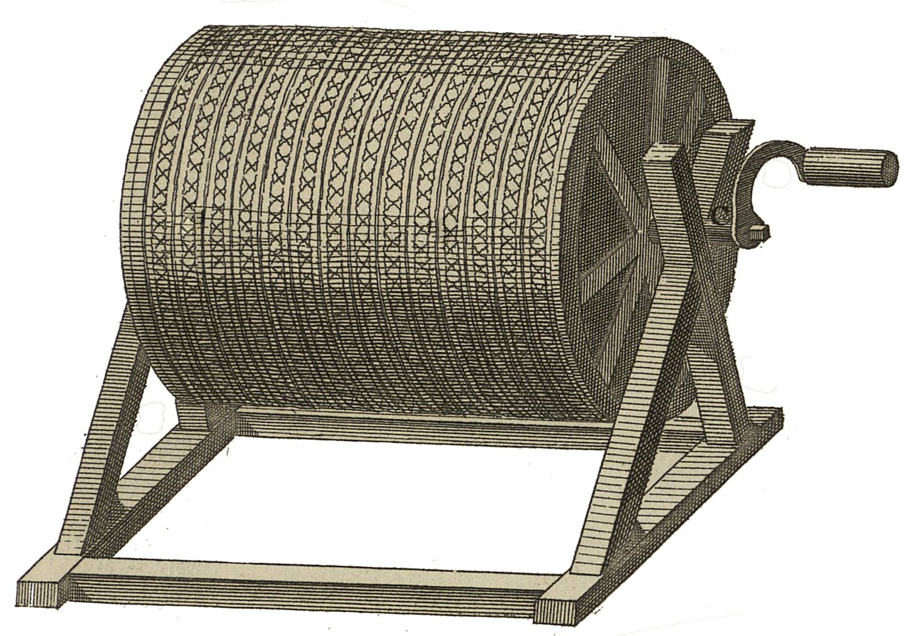

<div align="center" id="head">

<table>
<tr>
<td></td>
<td align="left">
<h1 style="margin:0">BookScan</h1>
<p style="margin:0.25em 0 0"><strong>Scan de livres · Companion · Android / PC</strong><br/>bookscan · pipeline OpenCV / Rust</p>
</td>
</tr>
</table>

<a href="https://atelier.atechnologie.fr/" title="l'Atelier – Association de fabrication de livres et d'outils de recherche"></a>  
<sub>Développé par <a href="https://atelier.atechnologie.fr/">l'Atelier</a> — fabrication de livres et outils de recherche (EHESS)</sub>

<p>
🇫🇷 <a href="README.md"><b>Français</b></a> ·
🇬🇧 <a href="README.en.md">English</a> ·
🇩🇪 <a href="README.de.md">Deutsch</a> ·
🇪🇸 <a href="README.es.md">Español</a>
</p>

<p>
<a href="https://atelier.atechnologie.fr/"></a>

</p>

</div>

---

## 📸 Aperçu

| Companion | Capture |
| :---: | :---: |
|  |  |

## 📖 À propos

**BookScan** — ensemble Atelier pour numériser des livres : application Android **bookscan** (capture) + companion bureau **bookscan-companion** (réception LAN, pipeline image, UI Livescan) + scripts utilitaires.

Le dépôt contient aussi un prototype Python Tkinter `atscanner/` **déprécié** (remplacé par le companion Rust).

## 🧩 Composants

| Élément | Technologie | Rôle |
|---------|-------------|------|
| `bookscan/` | Android (Gradle) | Capture (modes auto / semi / manuel), envoi vers le companion |
| `bookscan-companion/` | Rust (eframe/egui, axum) | Serveur LAN (port **7842**), pipeline CPU, export PDF, UI |
| `protocol/` | WebSocket JSON | Schéma `/v1/ws` (capture_now, set_mode, point_state…) |
| `atscanner/` | Python (OpenCV…) | Prototype UI déprécié |
| `scripts/` | bat / Python | Pare-feu, smoke test companion |

## ✨ Pipeline (companion)

Réception des pages → détection de document (quad) → redressement / crop → amélioration → bibliothèque locale → export PDF. Le companion expose aussi des étapes type retrait de doigts / écriture manuscrite côté pipeline.

## ⬇️ Installation / lancement

### Companion PC

```bat
run_companion.bat
```

- Lance `bookscan-companion/target/release/bookscan-companion.exe` s’il existe
- Sinon (ou avec `--rebuild`) : `cargo build --release` puis exécution
- Port par défaut : **7842** (`BOOKSCAN_PORT` pour le changer)

Pare-feu Windows (règle TCP 7842) :

```bat
scripts\open-firewall-bookscan.bat
```

### Application Android bookscan

```bat
cd bookscan
gradlew.bat assembleDebug
```

Installer l’APK, connecter le téléphone et le PC sur le même Wi‑Fi, pointer l’app vers l’IP du companion.

### Ancien lanceur Python

`run_atscanner.bat` et `python -m atscanner` sont **dépréciés** et redirigent vers le companion.

## 📚 Dépendances Python (prototype / outils)

Fichier `requirements.txt` :

* `opencv-python`, `numpy`, `Pillow`, `img2pdf`, `pytesseract`

## 📜 Scripts

| Script | Rôle |
|--------|------|
| `run_companion.bat` | Build/lancement du companion Rust |
| `run_atscanner.bat` | Déprécié → appelle `run_companion.bat` |
| `scripts/open-firewall-bookscan.bat` | Ouvre le port TCP 7842 |
| `scripts/smoke_companion.py` | Smoke test du companion |

## 🔗 Ressources

| | |
| --- | --- |
| 🌐 **l'Atelier** | [atelier.atechnologie.fr](https://atelier.atechnologie.fr/) |

---

<div align="center">

<sub>🇫🇷 <a href="README.md">Français</a> · <a href="README.en.md">🇬🇧 English</a> · <a href="README.de.md">🇩🇪 Deutsch</a> · <a href="README.es.md">🇪🇸 Español</a> · BookScan — <a href="https://atelier.atechnologie.fr/">l'Atelier</a></sub>

</div>
